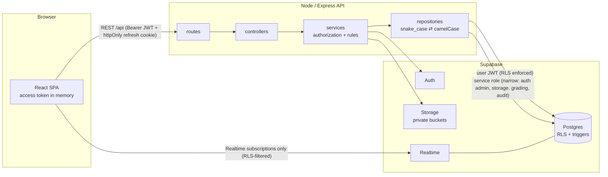

# GUTECH LMS Portal

A full-stack **student & faculty learning management system** for the German University of
Technology (GUtech) — built with **React 19, Node.js/Express, and Supabase** (Postgres, Auth,
Storage, Realtime).

Admins create accounts and courses; teachers publish resources, assignments and timed quizzes,
grade work and post announcements; students submit work, take quizzes, chat with their class
and track their marks. Every rule is enforced on the server **and** again in the database with
Row Level Security.

|                       |                                                                                          |
| --------------------- | ---------------------------------------------------------------------------------------- |
| **Live demo**         | `https://<your-project>.vercel.app` _(see [Deployment](#deployment))_                    |
| **Video walkthrough** | `<YouTube / Loom / Drive link>` _(script: [docs/VIDEO_SCRIPT.md](docs/VIDEO_SCRIPT.md))_ |
| **Demo password**     | `Gutech@2026` for every seeded account                                                   |

---

## Contents

1. [Features](#features)
2. [Tech stack](#tech-stack)
3. [Architecture](#architecture)
4. [Getting started (local, ≤ 10 steps)](#getting-started)
5. [Environment variables](#environment-variables)
6. [Demo accounts](#demo-accounts)
7. [Scripts](#scripts)
8. [Testing](#testing)
9. [Deployment](#deployment)
10. [Project structure](#project-structure)
11. [Security](#security)
12. [AI-assisted workflow](#ai-assisted-workflow)

More detail lives in [`docs/`](docs): [architecture](docs/ARCHITECTURE.md) ·
[API reference](docs/API.md) · [deployment](docs/DEPLOYMENT.md) ·
[testing & acceptance evidence](docs/TESTING.md) · [assumptions](docs/ASSUMPTIONS.md) ·
[AI workflow](docs/AI_WORKFLOW.md) · [video script](docs/VIDEO_SCRIPT.md).

---

## Features

| #   | Feature                  | Highlights                                                                                                                                                                                                                                                                                     |
| --- | ------------------------ | ---------------------------------------------------------------------------------------------------------------------------------------------------------------------------------------------------------------------------------------------------------------------------------------------- |
| 1   | **Login (no sign-up)**   | Email + password, role-based redirect (`/admin`, `/teacher`, `/student`), generic error message, 5 attempts / 15 min rate limit, deactivated users blocked (even with an old token), forced password change after a temporary password. `/signup` is a 404 and Supabase sign-ups are disabled. |
| 2   | **Resources**            | Drag-and-drop upload with progress bar, 25 MB limit, MIME type checked by **magic bytes** (renamed `.exe` files are rejected), private bucket, 60-second signed download URLs, search & pagination.                                                                                            |
| 3   | **Courses & enrollment** | Admin course CRUD (archive instead of delete), replace-the-set teacher assignment, multi-select enrollment and **CSV import with a preview** of matched / duplicate / unknown emails. Enrollment is idempotent.                                                                                |
| 4   | **Assignments**          | Instructions, optional attachment, due date, max marks, late policy. Students submit text and/or a file and can resubmit until the deadline; lateness is decided by the **server clock**. Teachers grade inline with feedback and file downloads.                                              |
| 5   | **Quizzes**              | Builder with MCQ (single/multi) and true/false, reorder, mark correct answers, preview, publish window, optional shuffle. Timed runner with navigator, confirm-submit and auto-submit. **Answer keys never reach the browser**; grading happens on the server; one attempt per student.        |
| 6   | **Announcements**        | Course and campus-wide posts, pinned first, unread badge updated live through **Supabase Realtime**, course filter.                                                                                                                                                                            |
| 7   | **Marks**                | Student “My marks” per course with totals and percentage (graded items only, ungraded = _Pending_). Teacher gradebook matrix with sticky first column, click-through to grading, and **Excel-friendly CSV export** (UTF-8 BOM).                                                                |
| 8   | **Classroom chat**       | One room per course, realtime delivery (< 2 s), infinite scroll upward, optimistic send with retry, soft delete (sender within 5 min / teacher / admin), 20 msg/min rate limit, HTML rendered as text.                                                                                         |
| 9   | **Complaints**           | Category, subject, description, optional course and attachment (10 MB). Status flow `open → in_review → resolved                                                                                                                                                                               | rejected`; a response is required to close; complainants get an **in-app notification** on every change and may add one follow-up. |
| 10  | **Password reset**       | Forgot-password with identical responses for known/unknown emails (3/hour/email), single-use 1-hour links with an expired-link state, strength meter, change-password in the profile, admin reset by email or temporary password. Every other session is revoked.                              |

Cross-cutting: role dashboards, notifications bell, audit log (grading, deletions, admin
changes), dark mode, responsive down to 360 px, keyboard navigation, loading / empty / error
states on every screen.

## Tech stack

| Layer           | Choice                                                                                                                                                                              |
| --------------- | ----------------------------------------------------------------------------------------------------------------------------------------------------------------------------------- |
| Frontend        | React 19, Vite 8, TypeScript (strict), React Router 7, TanStack Query 5, React Hook Form + Zod 4, Tailwind CSS 4, Radix UI (shadcn/ui-style components), Sonner, Lucide icons       |
| Backend         | Node 22, Express 5, TypeScript, Zod validation, Helmet, CORS allow-list, express-rate-limit, Multer, file-type (magic bytes), Pino logging                                          |
| Database & Auth | Supabase Postgres (8 ordered migrations, RLS on every table, guard triggers), Supabase Auth (email + password, sign-ups disabled), Storage (private buckets, signed URLs), Realtime |
| Testing         | Vitest + Supertest (unit, route contracts, integration against real Supabase), Playwright (E2E per role)                                                                            |
| Hosting         | Render (single service serving API + SPA) — or Vercel (web) + Render (API)                                                                                                          |

## Architecture



- **Two lines of defense.** The API authorizes every request (role + course membership) and then
  reads/writes with a Supabase client bound to the **caller's JWT**, so Postgres RLS re-checks
  everything. Guard triggers protect invariants (graders can't edit answers, students can't set
  grades, lateness is stamped by the database clock, complaint status flow, immutable chat).
- **The service role** is used only for narrow server tasks: Auth admin calls, storage objects and
  signed URLs, quiz attempts/grading (so students can never write a score), audit log and
  notifications. It never reaches the browser.
- **Answer keys** live in a separate `quiz_answers` table that students cannot read, even with a
  direct Supabase call.

Database schema, RLS matrix and request flows: [docs/ARCHITECTURE.md](docs/ARCHITECTURE.md).

## Getting started

**Prerequisites:** Node.js 20+ (22 recommended), npm 10+, Docker (for the local Supabase stack).

1. Clone the repo and install dependencies:
   ```bash
   git clone https://github.com/Hasan-Abdullah-Jan/LMS.git && cd LMS && npm install
   ```
2. Start local Supabase — this applies all migrations and loads the demo seed:
   ```bash
   npm run db:start
   ```
3. Print the local URLs and keys:
   ```bash
   npx supabase status
   ```
4. Create the API env file and paste `API URL`, `anon key` and `service_role key`:
   ```bash
   cp apps/api/.env.example apps/api/.env
   ```
5. Create the web env file and paste the same `API URL` and `anon key`:
   ```bash
   cp apps/web/.env.example apps/web/.env
   ```
6. Run the API and the web app together:
   ```bash
   npm run dev
   ```
7. Open <http://localhost:5173> and sign in with a [demo account](#demo-accounts).
8. Reset the database to a clean demo state at any time:
   ```bash
   npm run db:reset
   ```

> Password-reset emails are captured locally by Supabase's mail catcher (Mailpit) at
> <http://localhost:54324>.

## Environment variables

**`apps/api/.env`** (server only — never commit it)

| Variable                    | Example                                | Purpose                                                              |
| --------------------------- | -------------------------------------- | -------------------------------------------------------------------- |
| `PORT`                      | `4000`                                 | API port                                                             |
| `CLIENT_ORIGIN`             | `http://localhost:5173`                | Comma-separated CORS allow-list                                      |
| `SUPABASE_URL`              | `http://127.0.0.1:54321`               | Supabase project URL                                                 |
| `SUPABASE_ANON_KEY`         | `eyJ…` / `sb_publishable_…`            | Public key (used for user-scoped clients)                            |
| `SUPABASE_SERVICE_ROLE_KEY` | `eyJ…` / `sb_secret_…`                 | **Secret.** Server-only admin key                                    |
| `PASSWORD_RESET_REDIRECT`   | `http://localhost:5173/reset-password` | Where reset emails land (must be in Supabase redirect URLs)          |
| `COOKIE_SAMESITE`           | `lax`                                  | `lax` when web & API share a site; `none` for cross-site             |
| `SERVE_WEB`                 | `false`                                | `true` to serve `apps/web/dist` from the API (single-service deploy) |
| `LOG_LEVEL`                 | `info`                                 | Pino log level                                                       |

**`apps/web/.env`** (public, inlined at build time)

| Variable                  | Example                  | Purpose                                            |
| ------------------------- | ------------------------ | -------------------------------------------------- |
| `VITE_API_URL`            | `/api`                   | API base URL (`/api` is proxied to `:4000` in dev) |
| `VITE_SUPABASE_URL`       | `http://127.0.0.1:54321` | For Realtime only                                  |
| `VITE_SUPABASE_ANON_KEY`  | `eyJ…`                   | Public anon key — **never** the service-role key   |
| `VITE_SHOW_DEMO_ACCOUNTS` | `true`                   | Show the demo-account helper on the login page     |

## Demo accounts

All seeded accounts use the password **`Gutech@2026`**.

| Role    | Email                       | Notes                                            |
| ------- | --------------------------- | ------------------------------------------------ |
| Admin   | `admin@gutech.demo`         | Registrar office                                 |
| Teacher | `aisha.balushi@gutech.demo` | Teaches CS101, MATH150                           |
| Teacher | `omar.rawahi@gutech.demo`   | Teaches CS201, MATH150                           |
| Student | `fatima.hinai@gutech.demo`  | CS101, CS201, MATH150                            |
| Student | `yousuf.lawati@gutech.demo` | CS101, CS201                                     |
| Student | `maryam.kindi@gutech.demo`  | CS101, CS201, MATH150                            |
| Student | `salim.farsi@gutech.demo`   | CS101, MATH150                                   |
| Student | `noor.saadi@gutech.demo`    | Holds a temporary password → forced to change it |

The seed includes graded and pending submissions, a completed quiz with scores, a quiz that is
**open right now**, a draft quiz, pinned/global announcements, chat history, complaints in every
status and audit entries — enough to walk all three roles end to end.

## Scripts

| Command                                                 | What it does                                               |
| ------------------------------------------------------- | ---------------------------------------------------------- |
| `npm run dev`                                           | API (tsx watch) + web (Vite) together                      |
| `npm run build`                                         | Type-check and build API and web                           |
| `npm start`                                             | Start the built API (serves the SPA when `SERVE_WEB=true`) |
| `npm test`                                              | Unit + route-contract tests (no database needed)           |
| `npm run test:integration`                              | Acceptance suite against the running Supabase (41 tests)   |
| `npm run test:e2e`                                      | Playwright flows per role (requires `npm run dev`)         |
| `npm run lint` / `npm run typecheck` / `npm run format` | Quality gates                                              |
| `npm run db:start` / `db:reset` / `db:stop`             | Local Supabase lifecycle (`db:reset` = migrations + seed)  |
| `npm run db:push`                                       | Push migrations + seed to a linked hosted project          |

## Testing

| Suite                                          | Count | What it proves                                                                                                                                             |
| ---------------------------------------------- | ----- | ---------------------------------------------------------------------------------------------------------------------------------------------------------- |
| API unit & route contracts (`apps/api/tests`)  | 147   | Every endpoint: happy path **and** a permission-denied case; validation (422), malformed JSON (400), pagination caps, grading/CSV/file-type/password rules |
| API integration (`apps/api/tests/integration`) | 41    | Every acceptance criterion from the spec against a real Supabase (RLS, storage, auth, realtime-relevant policies)                                          |
| Web unit (`apps/web/src/**/*.test.ts`)         | 7     | Role routing, formatting, password policy                                                                                                                  |
| Playwright E2E (`e2e/`)                        | 10    | One full flow per role + auth guards + realtime chat between two browsers                                                                                  |

Acceptance criteria with evidence: [docs/TESTING.md](docs/TESTING.md). CI runs all of them on every
push ([`.github/workflows/ci.yml`](.github/workflows/ci.yml)).

## Deployment

**Vercel — one project, one URL** (website + API function; no URL variables to maintain):

1. In Supabase **SQL Editor**, paste and run [`supabase/setup.sql`](supabase/setup.sql) (schema + demo
   data). If it reports `type "user_role" already exists`, run [`supabase/reset-hosted.sql`](supabase/reset-hosted.sql) first, then `setup.sql` again. Under **Authentication → Sign In / Providers** turn **off** _Allow new users to sign up_.
2. In Vercel, **Add New → Project**, import this repo (keep the root directory) and set three
   environment variables: `SUPABASE_URL`, `SUPABASE_ANON_KEY`, `SUPABASE_SERVICE_ROLE_KEY`.
3. Deploy, then sign in with a demo account.

Details, limits (4.5 MB upload cap on Vercel) and the Render alternative:
[docs/DEPLOYMENT.md](docs/DEPLOYMENT.md).

## Project structure

```
.
├── apps/
│   ├── api/                      # Node + Express (TypeScript)
│   │   ├── src/
│   │   │   ├── config/           # env (Zod-validated), logger, Supabase clients
│   │   │   ├── middleware/       # auth, rate limits, uploads, error handler
│   │   │   ├── routes/           # routers per area (auth, admin, app)
│   │   │   ├── controllers/      # HTTP <-> service mapping (no Supabase calls)
│   │   │   ├── services/         # business rules + authorization
│   │   │   ├── repositories/     # all Supabase access, snake_case <-> camelCase
│   │   │   ├── schemas/          # Zod request schemas
│   │   │   ├── lib/              # errors, pagination, files, CSV, grading, …
│   │   │   └── types/            # generated database types, auth types
│   │   └── tests/                # unit, route contracts, integration
│   └── web/                      # React + Vite (TypeScript)
│       └── src/
│           ├── app/              # router, layout, providers, error pages
│           ├── components/ui/    # shadcn-style primitives (Radix + Tailwind)
│           ├── components/common # page header, states, badges, dropzone, …
│           ├── features/         # auth, dashboard, courses, resources, assignments,
│           │                     # quizzes, announcements, marks, chat, complaints, admin
│           └── lib/              # API client, Supabase realtime, types, utils
├── supabase/
│   ├── migrations/               # 0001_core … 0008_auth_helpers
│   ├── seed.sql                  # demo data
│   └── config.toml               # local stack (sign-ups disabled)
├── e2e/                          # Playwright specs
├── docs/                         # architecture, API, deployment, testing, assumptions, …
└── render.yaml                   # Render Blueprint
```

## Security

- No public sign-up anywhere (no route, no UI, disabled in Supabase Auth).
- Zod validation on every request body, query and route parameter; 1 MB JSON limit; per-route
  upload limits; MIME validated by magic bytes.
- Access token kept in memory only; refresh token in an `httpOnly` cookie scoped to `/api/auth`.
- Deactivation bans the Auth user, revokes all sessions and is re-checked on every request.
- RLS enabled on every table; storage buckets are private with no client policies; downloads use
  60-second signed URLs.
- Helmet (strict CSP in single-service mode), CORS allow-list, rate limits (login, forgot password,
  chat, global), audit trail, secrets only in environment variables, tokens/passwords redacted
  from logs, user text rendered as text (no `dangerouslySetInnerHTML`).

## AI-assisted workflow

This project was built with an AI pair-programmer (Claude Code) driving a spec-first,
test-verified loop: spec → schema & RLS → API layers → UI → tests against real infrastructure →
fix → document. The full write-up, including the bugs the tests caught and how they were fixed,
is in [docs/AI_WORKFLOW.md](docs/AI_WORKFLOW.md).
