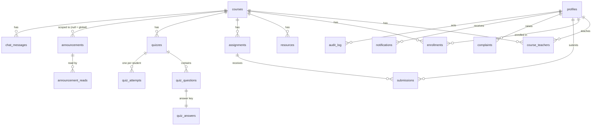

# Architecture

## Overview

```
Browser (React SPA)
  │  REST /api/*  — Authorization: Bearer <access token in memory>
  │                 + httpOnly refresh cookie (path /api/auth)
  ▼
Express API  routes → controllers → services → repositories
  │  user-scoped Supabase client (caller's JWT → RLS applies)
  │  service-role client (narrow, server-only tasks)
  ▼
Supabase: Postgres (RLS + triggers) · Auth · Storage · Realtime
  ▲
  └── Browser subscribes to Realtime only (chat, announcements, notifications), RLS-filtered
```

### API layering

| Layer           | Responsibility                                                                                       | Rule                                   |
| --------------- | ---------------------------------------------------------------------------------------------------- | -------------------------------------- |
| `routes/`       | URL → middleware chain → controller                                                                  | Role guards (`requireRole`) live here  |
| `controllers/`  | Parse & validate input with Zod, call a service, shape the response                                  | **No Supabase calls**                  |
| `services/`     | Business rules, course-level authorization (`courseRole`, `assertCourseStaff`), audit, notifications | Throw `AppError` for expected failures |
| `repositories/` | All Supabase access; map `snake_case` rows ⇄ `camelCase` DTOs in one place                           | Never leak storage paths               |

Responses use one envelope: `{ "data": …, "meta": { "page", "pageSize", "total" } }` or
`{ "error": { "code", "message", "details": [{ "path", "message" }] } }`.

### Request lifecycle

1. `helmet` → CORS allow-list → `pino-http` (no bodies/tokens logged) → JSON (1 MB) → cookies.
2. Global rate limit (300 req/min/IP), then route-specific limiters (login, forgot password, chat).
3. `requireAuth`: verifies the JWT with Supabase Auth (catches revoked sessions), loads the profile,
   rejects deactivated users, attaches `req.user` and a user-scoped `req.db`.
4. `requirePasswordChanged`: blocks everything except `/auth/*` until a temporary password is changed.
5. Controller validates with Zod (422 with field details) → service authorizes → repository.
6. A single error handler maps `AppError`, Multer, body-parser and Postgres errors to the envelope.

### Authentication flow

1. `POST /api/auth/login` → Supabase `signInWithPassword` → response body has the access token and
   profile; the refresh token is set as an `httpOnly`, `SameSite`-configurable cookie on `/api/auth`.
2. The SPA keeps the access token in memory and schedules a silent refresh one minute before
   expiry. Any 401 triggers one single-flight refresh + retry.
3. On page load the SPA calls `POST /api/auth/refresh` (204 when there is no cookie).
4. `POST /api/auth/logout` revokes the Supabase session and clears the cookie.
5. Password reset: Supabase emails a single-use link → `/reset-password#access_token=…&type=recovery`
   → the SPA posts the new password with that token → the API checks the token is a recovery
   (`amr: otp`) session, sets the password, and **deletes every session** (so the link and the old
   password stop working immediately).

## Database

Migrations (`supabase/migrations`):

| File                        | Contents                                                                                                                                                                                                                                                                        |
| --------------------------- | ------------------------------------------------------------------------------------------------------------------------------------------------------------------------------------------------------------------------------------------------------------------------------- |
| `0001_core.sql`             | Enums, `profiles`, `courses`, `course_teachers`, `enrollments`, `audit_log`, `set_updated_at()`, authorization helpers `auth_role()`, `is_admin()`, `is_enrolled()`, `teaches()`, `is_course_member()`, `can_view_profile()` (all `SECURITY DEFINER`, anchored on `auth.uid()`) |
| `0002_learning.sql`         | `resources`, `assignments`, `submissions`, `quizzes`, `quiz_questions`, `quiz_answers`, `quiz_attempts`                                                                                                                                                                         |
| `0003_communication.sql`    | `announcements`, `announcement_reads`, `chat_messages`, `complaints`, `notifications`                                                                                                                                                                                           |
| `0004_views.sql`            | `v_student_marks` (security invoker) — unions assignment and quiz marks                                                                                                                                                                                                         |
| `0005_rls.sql`              | RLS enabled on every table + policies; anon role revoked                                                                                                                                                                                                                        |
| `0006_guards.sql`           | Integrity triggers (see below)                                                                                                                                                                                                                                                  |
| `0007_storage_realtime.sql` | Private buckets with size/MIME limits; Realtime publication                                                                                                                                                                                                                     |
| `0008_auth_helpers.sql`     | `revoke_user_sessions()` (service role only)                                                                                                                                                                                                                                    |

### Entity relationships



Marks are **derived, never duplicated**: assignment marks live in `submissions.marks_obtained`,
quiz marks in `quiz_attempts.score`; `v_student_marks` exposes
`(student_id, course_id, kind, item_id, title, obtained, max, graded_at)`.

Indexes cover every list query (course + date ordering, status queues, membership lookups).

### RLS summary

| Table            | Student                                 | Teacher                           | Admin                |
| ---------------- | --------------------------------------- | --------------------------------- | -------------------- |
| `profiles`       | self + people sharing a course          | self + people sharing a course    | all (update)         |
| `courses`        | enrolled, not archived                  | taught, not archived              | all (write)          |
| `resources`      | read (enrolled)                         | read/insert (taught), delete own  | all                  |
| `assignments`    | read (enrolled)                         | CRUD (taught)                     | all                  |
| `submissions`    | **own only**; insert/update own         | read/grade (taught)               | all                  |
| `quizzes`        | published (enrolled)                    | CRUD (taught)                     | all                  |
| `quiz_questions` | only after starting an attempt          | CRUD (taught)                     | all                  |
| `quiz_answers`   | **never**                               | read/write (taught)               | all                  |
| `quiz_attempts`  | read own (writes via server)            | read (taught)                     | read                 |
| `announcements`  | global + enrolled                       | global + taught; write own course | all                  |
| `chat_messages`  | members read/insert; delete own ≤ 5 min | members; delete any (taught)      | read; delete         |
| `complaints`     | own; one follow-up                      | own; one follow-up                | all; status/response |
| `notifications`  | own (only `read_at` updatable)          | own                               | own                  |
| `audit_log`      | —                                       | —                                 | read                 |

Storage buckets (`resources`, `submissions`, `complaint-attachments`) are private and have no
client policies at all: the API authorizes, uploads with the service role and hands out
60-second signed URLs.

### Guard triggers (`0006_guards.sql`)

- **Submissions:** for students, `submitted_at` and `is_late` are stamped with the DB clock, late
  work is refused when `allow_late = false`, and any previous grade is cleared on resubmission.
  Graders may only change marks/feedback, marks may not exceed `max_marks`, and `graded_by/at`
  are stamped automatically.
- **Quizzes:** once an attempt exists only `is_published` can change; questions and answer keys are
  frozen.
- **Chat:** messages are immutable; deletion is a one-way soft delete.
- **Complaints:** contents are immutable after filing; status flow
  `open → in_review → resolved | rejected`; a response is required to close; complainants can add
  exactly one follow-up.
- **Profiles:** email/id cannot drift from Auth; users cannot change their own role or status.

## Frontend

- **Routing:** React Router 7 data router with lazy-loaded routes, `RequireAuth`, `RequireRole`,
  `PublicOnly` guards, role homes `/admin`, `/teacher`, `/student`, and a 404 for everything else
  (including `/signup`).
- **Data:** TanStack Query for caching, pagination (`keepPreviousData`), infinite chat history and
  optimistic updates. Retries are disabled for 4xx errors.
- **Realtime:** a browser Supabase client whose `accessToken` callback returns the in-memory JWT,
  so subscriptions are always RLS-filtered for the current user.
- **UI kit:** shadcn/ui-style components on Radix primitives + Tailwind CSS 4 design tokens
  (light/dark, WCAG AA contrast), every screen with loading, empty and error states.
